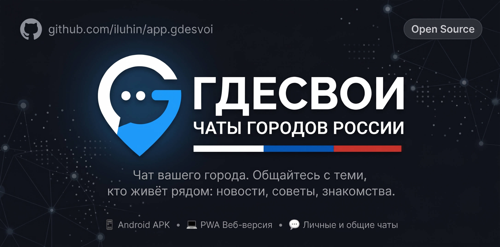

[Русский](README.md) · [English](README.en.md) · [Español](README.es.md) · **简体中文**

# ГдеСвои

**你所在城市的聊天室。** 与住在附近的人交流：社区新闻、生活建议、
“哪里有卖”“谁见过”，或是随意聊聊——既可以在城市公共聊天室交流，
也可以发送私信。

[**💬 打开聊天室**](https://gdesvoi.ru/) ·
[**⬇ 下载 Android 版**](https://gdesvoi.ru/update.php?a=download) ·
[**📖 维基**](../../wiki)

---

## 使用方式

选择城市，即可进入该城市的聊天室。目前已开放 170 多座城市，涵盖所有大城市
及各地区首府，从摩尔曼斯克到克拉斯诺达尔，从加里宁格勒到符拉迪沃斯托克。
轻点一下，即可通过地理位置识别所在城市。

| | |
|---|---|
| 💬 | 城市公共聊天室和私信，一键回复 |
| ❤️ | 消息表情回应和个人资料点赞 |
| 💞 | 18 岁及以上用户可使用的“Знакомства”（约会）专区，提供交友资料和相互点赞功能 |
| 📸 | 个人资料支持大幅照片、圆形头像、表情符号及所在城市的背景 |
| 📎 | 直接在消息中发送照片、视频和 PDF 文件 |
| 👥 | 查看谁在线、谁暂时离开 |
| 🤖 | AI 聊天伙伴：叫出它的名字，它就会显示“正在输入”并回复 |
| 🎨 | 浅色和深色主题，以及多种配色方案 |

注册时填写姓名、邮箱和密码，再通过邮件中的验证码确认邮箱。
如果管理员开启了访客访问，也可以不注册先来看看。

## Android 应用

- **原生应用般的体验。** 聊天室在后台加载时显示带有品牌动画的启动画面；
  “Назад”（返回）可关闭窗口和版块；专门的离线页面会在网络恢复后自动打开聊天室。
- **网站上的功能一应俱全。** 附件、相册照片、城市识别、约会、个人资料——
  与网站使用同一个账号。
- **无需多余权限。** 互联网和大致地理位置——仅通过“Определить город”（识别城市）
  按钮使用。更新由应用商店安装。
- **轻量。** 大约 100 KB，无广告、无跟踪器。
- **需要** Android 7.0 或更高版本。

可从[版本发布页面](../../releases)或直接从
[网站](https://gdesvoi.ru/update.php?a=download)下载文件——所有版本都使用同一个密钥签名，
因此更新可以覆盖安装。

## iPhone 和电脑

目前没有独立的 iPhone 应用，但网站是一个 PWA：依次选择“Поделиться”（分享）→
“На экран „Домой“”（添加到主屏幕），即可获得启动图标，并在没有地址栏的窗口中打开。
在 Android 和电脑上的 Chrome 中，选择“⋮”菜单 →“Установить приложение”（安装应用），
或选择聊天室个人资料菜单中的“Установить приложение”（安装应用）。

## 版本历史

所有版本及其说明均可在[版本发布页面](../../releases)和
[维基](../../wiki/Versions)中查看。最新文件始终附在
[最新版本](../../releases/latest)中，网站提供的也是同一个文件。

## 此仓库的内容

这里只包含发布版本和项目介绍：版本说明（`releases/`）、构建安装包（`apk/`）
和维基页面（`wiki/`）。网站和应用的源代码不公开。

## 问题与建议

如果遇到故障、未收到验证码邮件、找不到你所在的城市，或有任何想法，
请前往 [Issues](../../issues)。

---

© Илья Анисимов · [iluh.in](https://iluh.in)
